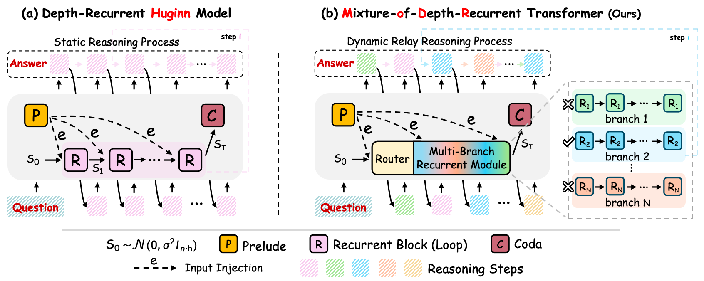
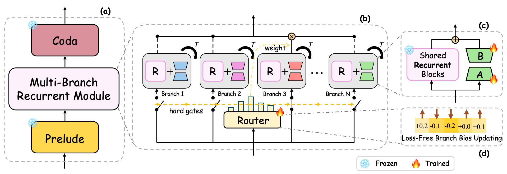
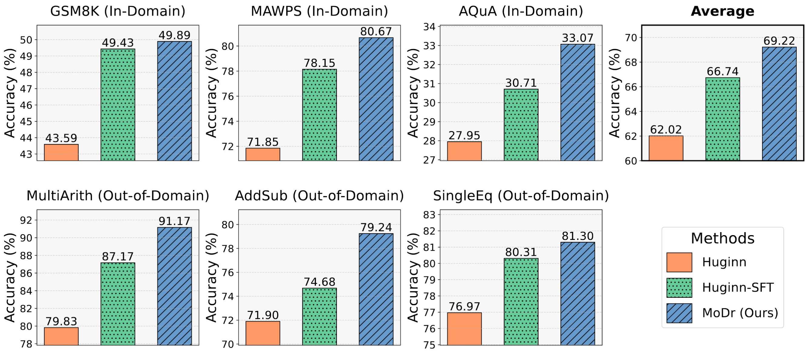
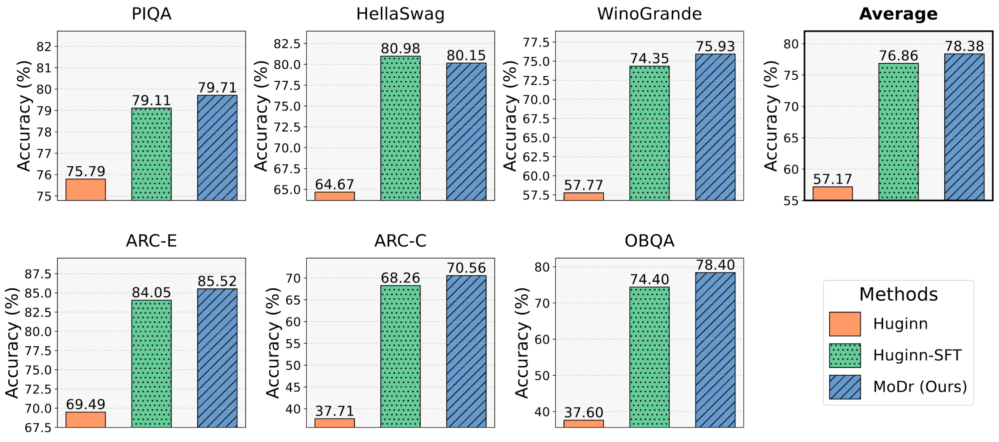

<p align="center">
  <h3 align="center">MoDr: Mixture-of-Depth-Recurrent Transformers for Test-Time Reasoning</h3>
</p>

> This work is accepted by ICLR'26.

## Abstract

Large Language Models have demonstrated superior reasoning capabilities by generating step-by-step reasoning in natural language before deriving the final answer. Recently, Geiping et al. (2025) introduced 3.5B-Huginn as an alternative to this paradigm, a depth-recurrent Transformer that increases computational depth per token by reusing a recurrent block in latent space. Despite its performance gains with increasing recurrences, this approach is inadequate for tasks demanding exploration and adaptivity, a limitation arising from its single, chain-like propagation mechanism. To address this, we propose a novel dynamic multi-branches routing approach for Huginn, termed as **M**ixture-**o**f-**D**epth-**R**ecurrent (MoDr) Transformer, which enables effective exploration of the solution space by shifting linear latent reasoning into a LoRA-based multi-branch dynamic relay mode with a learnable hard-gate routing. Meanwhile, we introduce an auxiliary-loss-free load balancing strategy to mitigate the potential routing collapse. Our empirical results reveal that MoDr achieves average accuracy improvements of +7.2% and +2.48% over the original Huginn model and its fine-tuned variant, respectively, across various mathematical reasoning benchmarks and improvements of +21.21% and +1.52% on commonsense reasoning benchmarks.

## Framework Overview

<div align="center">
  
</div>

## Methodology

<div align="center">
  
</div>

## Key Features

- **Dynamic Multi-Branch Routing**: Enables effective exploration of the solution space through LoRA-based multi-branch dynamic relay mode
- **Learnable Hard-Gate Routing**: Implements a learnable routing mechanism for adaptive branch selection
- **Auxiliary-Loss-Free Load Balancing**: Mitigates routing collapse without additional auxiliary losses
- **Strong Performance**: Achieves significant improvements on mathematical and commonsense reasoning benchmarks

## Installation

### Setup

1. Clone the repository:
```bash
git clone https://github.com/zhangxjohn/MoDr.git
cd MoDr
```

2. Install training dependencies:
```bash
cd train
pip install -r requirements.txt
```

3. Install evaluation dependencies:
```bash
cd ../evaluation
pip install -r requirements.txt
```

## Quick Start

### Training

We provide training scripts for different tasks:

#### Mathematical Reasoning
```bash
bash train/scripts/run_modr_math.sh
```

#### Commonsense Reasoning
```bash
bash train/scripts/run_modr_cs.sh
```

#### Code Generation
```bash
bash train/scripts/run_modr_code.sh
```

### Evaluation

After training, you can evaluate the model on various benchmarks:

```bash
cd evaluation
python eval_hf.py \
    --model_name_or_path /path/to/checkpoint \
    --origin_model_path /path/to/base/model \
    --data_name "gsm8k" \
    --temperature 0.0001 \
    --start_idx 0 \
    --end_idx -1 \
    --split "test" \
    --max_tokens 1024 \
    --top_p 0.95 \
    --seed 0 \
    --num_steps 16 \
    --num_choices 1 \
    --surround_with_messages \
```

## Performance

### Mathematical Reasoning

<div align="center">
  
</div>

MoDr achieves average accuracy improvements of **+7.2%** and **+2.48%** over the original Huginn model and its fine-tuned variant, respectively, across various mathematical reasoning benchmarks.

### Commonsense Reasoning

<div align="center">
  
</div>

MoDr shows improvements of **+21.21%** and **+1.52%** on commonsense reasoning benchmarks compared to the original Huginn model and its fine-tuned variant.

## Citation

If you find MoDr useful or relevant to your research, please consider citing our paper:

```bibtex
@inproceedings{zhang2026modr,
  title={MoDr: Mixture-of-Depth-Recurrent Transformers for Test-Time Reasoning},
  author={Zhang, Xiaojing and Wu, Haifeng and He, Gang and Shen, Jiyang and Lyu, Bochen and Zhu, Zhanxing},
  booktitle={ICLR},
  year={2026}
}
```

## Acknowledgments

We thank the Huginn team for their valuable contributions to the depth-recurrent Transformer architecture. The original Huginn implementation can be found at [recurrent-pretraining](https://github.com/seal-rg/recurrent-pretraining).